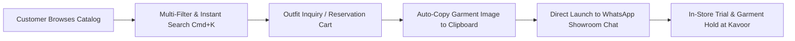

# AB Collections — Luxury Men's Retail & Digital Catalog

[](https://nextjs.org/)
[](https://react.dev/)
[](https://www.typescriptlang.org/)
[](https://tailwindcss.com/)
[](https://turbo.build/)
[](LICENSE)

An editorial, high-performance retail and e-commerce platform custom-engineered for **AB Collections**, a premier menswear destination located in Kavoor, Mangaluru. Built with a focus on razor-sharp typography, hardware-accelerated animations, zero-friction WhatsApp commerce, and modern luxury design principles.

---

## Table of Contents

- [Architectural Overview](#architectural-overview)
- [Key Features](#key-features)
- [Tech Stack & Dependencies](#tech-stack--dependencies)
- [Project Directory Structure](#project-directory-structure)
- [Getting Started](#getting-started)
  - [Prerequisites](#prerequisites)
  - [Installation](#installation)
  - [Local Development](#local-development)
  - [Production Build](#production-build)
- [Design System & Engineering Standards](#design-system--engineering-standards)
- [WhatsApp Direct Commerce Pipeline](#whatsapp-direct-commerce-pipeline)
- [Configuration & Data Management](#configuration--data-management)
- [Performance & SEO](#performance--seo)
- [Deployment](#deployment)
- [License](#license)

---

## Architectural Overview

AB Collections is architected as an offline-first retail hybrid web application. Rather than imposing conventional credit card checkouts with cart abandonment overhead, the platform utilizes a **Zero-Friction WhatsApp Reservation Flow**:

1. **Client-Side Discovery & Curation:** Customers browse high-resolution flat-lays, tactical cargos, and evening jacquards with multi-facet filtering (category, fit, size, color, fabric).
2. **Instant Reservation & Inquiry:** Users build multi-garment in-store trial requests or trigger 1-click outfit inquiries.
3. **Automated Clipboard & Direct Deep Linking:** Product specifications are compiled into clean structured payloads, high-resolution garment photos are automatically staged to the system clipboard, and chats launch directly to the showroom team via WhatsApp (`+91 77604 68902`).



---

## Key Features

- **Editorial Brand Preloader:** Physics-based gravity drop and elastic bounce animation (`dropBounce`) for the central `AB` monogram, followed by a staggered letter-by-letter reveal (`letterReveal`) of `COLLECTIONS` and a smooth upward theatre-curtain wipe.
- **Bespoke Capsule Pill Buttons:** Signature luxury button design system (`PillButton.tsx`) featuring high-contrast circular arrow badges (`ArrowUpRight`) with coordinated micro-glide hover animations.
- **Elevated Navigation Bar:** Floating frosted glass container (`backdrop-blur-xl`) with live real-time badge counters, location indicator tooltip, and quick `Cmd + K` search launcher.
- **Global Search Overlay (`Cmd + K`):** Instant keyboard-triggered command palette for live garment fuzzy search, trending search tags, and rapid product navigation.
- **Interactive Footer Glide Motion:** Clean monochrome design with tactile hover glide physics (`translate-x-2.5` slide with contextual directional arrow).
- **Reveal On Scroll (`RevealOnScroll.tsx`):** Lightweight, zero-dependency `IntersectionObserver` wrapper powering staggered fade-and-rise animations across all landing sections.
- **Zero AI-Icon Noise:** Completely sanitized design aesthetic eliminating generic glitter/sparkle iconography and artificial gradients in favor of refined monochrome luxury and high-contrast typography.
- **Cart-Style Multi-Garment Reservation (`ReserveContext`):** Allows customers to bundle multiple shirts, trousers, and coordinates for a unified hold request with size and color specifications.
- **Mobile-Responsive Catalog Drawer:** Slide-out filter panel on small viewports with quick chip resets and real-time product counts.

---

## Tech Stack & Dependencies

| Layer | Technology | Version | Purpose |
| :--- | :--- | :--- | :--- |
| **Framework** | Next.js (App Router) | `16.4.0` | Server Components, Turbopack, Image Optimization |
| **Runtime** | React | `19.3.0` | Concurrent rendering, hooks, component primitives |
| **Language** | TypeScript | `^5.0.0` | Strict type safety, domain interfaces |
| **Styling** | Tailwind CSS | `^4.0.0` | Utility-first CSS, CSS variables, native `@theme` |
| **Iconography** | Lucide React | `^1.56.0` | Clean, standardized vector icons |
| **State** | React Context API | Native | Client-side persistent state (`localStorage`) |

---

## Project Directory Structure

```text
ab-collections/
├── public/
│   ├── catalog/              # High-resolution showroom apparel flat-lays
│   ├── images/
│   │   ├── products/         # Product gallery photography
│   │   ├── store/            # Kavoor showroom interior and exterior imagery
│   │   └── ui/               # Lookbook and editorial assets
│   ├── favicon.ico           # Application favicon
│   ├── robots.txt            # Search crawler directives
│   └── sitemap.xml           # Automated sitemap
├── src/
│   ├── app/
│   │   ├── layout.tsx        # Root layout with JSON-LD, Preloader & Providers
│   │   ├── page.tsx          # Homepage with Hero, Bento, Live Filters & Stories
│   │   ├── globals.css       # Custom keyframes, typography tracking & glass panels
│   │   ├── shop/             # Filterable product catalog with sidebar
│   │   ├── product/[slug]/   # Dynamic product detail page with size selectors
│   │   ├── lookbook/         # Curated fashion lookbook and styling archives
│   │   ├── reserve/          # Multi-item WhatsApp in-store trial reservation
│   │   ├── wishlist/         # Saved items with direct reservation moves
│   │   ├── about/            # Showroom atelier story & Kavoor roots
│   │   ├── contact/          # Interactive maps, showroom hours & directions
│   │   ├── faq/              # Fitting, reservation, and exchange guidelines
│   │   ├── privacy/          # In-store trial terms & exchange policies
│   │   └── not-found.tsx     # Custom editorial 404 handler
│   ├── components/
│   │   ├── layout/
│   │   │   ├── BrandPreloader.tsx   # Physics drop-bounce & letter reveal splash
│   │   │   ├── Navbar.tsx           # Floating blur navbar with Cmd+K & badges
│   │   │   ├── Footer.tsx           # Monochromatic footer with link glide physics
│   │   │   ├── AnnouncementBar.tsx  # Dynamic marquee top announcement
│   │   │   └── WhatsAppFloating.tsx # Floating direct inquiry button
│   │   ├── catalog/
│   │   │   ├── InquiryModal.tsx     # WhatsApp inquiry modal with photo auto-copy
│   │   │   ├── CatalogCard.tsx      # Garment catalog display card
│   │   │   ├── CatalogFilterBar.tsx # Dynamic category chip filter bar
│   │   │   └── CatalogModal.tsx     # Expanded high-res look viewer
│   │   ├── home/
│   │   │   ├── HeroSection.tsx      # Editorial typography hero with mini cards
│   │   │   ├── DarkBentoSection.tsx # Obsidian bento grid with showroom photo
│   │   │   ├── ColorStorySection.tsx# 4 curated seasonal color palettes
│   │   │   ├── LiveFilterBar.tsx    # Live category, fit & price selector
│   │   │   ├── MarqueeStrip.tsx     # Continuous animated fashion ticker
│   │   │   ├── ValueProps.tsx       # Core brand pillars
│   │   │   └── VisitStoreSection.tsx# Live hours, map embed, directions
│   │   ├── product/
│   │   │   ├── ProductCard.tsx      # Standard product listing card
│   │   │   ├── QuickViewModal.tsx   # Instant item preview with size selector
│   │   │   ├── SearchOverlay.tsx    # Cmd+K global search palette
│   │   │   └── SizeGuideModal.tsx   # Apparel measurement standards
│   │   └── ui/
│   │       ├── PillButton.tsx       # Signature capsule button with circular badge
│   │       ├── Badge.tsx            # Minimalist typography status badges
│   │       └── RevealOnScroll.tsx   # Hardware-accelerated scroll reveal wrapper
│   ├── config/
│   │   └── site.ts           # Central configuration: coordinates, phone, metadata
│   ├── context/
│   │   ├── ReserveContext.tsx# Multi-item reservation builder with localStorage
│   │   └── WishlistContext.tsx# Saved items state with localStorage persistence
│   ├── data/
│   │   ├── products.ts       # Typed catalog dataset across 11 apparel categories
│   │   └── catalog.ts        # Comprehensive showroom inventory items
│   ├── types/
│   │   └── index.ts          # Core domain models (Product, Filter, CartItem)
│   └── utils/
│       └── whatsappImage.ts  # Clipboard image conversion and download helpers
├── package.json              # Project scripts and dependencies
├── next.config.ts            # Next.js compiler and image domains configuration
├── tsconfig.json             # Strict TypeScript configuration
└── README.md                 # Project documentation
```

---

## Getting Started

### Prerequisites

Ensure the following tools are installed in your environment:
- **Node.js:** `v20.x` or higher (LTS recommended)
- **Package Manager:** `npm` (v10+), `pnpm`, or `yarn`

### Installation

1. Clone the repository:
   ```bash
   git clone https://github.com/Ashith04/AB-Collections.git
   cd AB-Collections
   ```

2. Install dependencies:
   ```bash
   npm install
   ```

### Local Development

Start the development server with Next.js Turbopack:

```bash
npm run dev
```

Open [http://localhost:3000](http://localhost:3000) in your browser to view the application.

### Production Build

To verify type checking, compile production bundles, and test optimizations:

```bash
# Compile and build production bundles
npm run build

# Start the production server
npm run start
```

### Code Linting

Run ESLint across the codebase:

```bash
npm run lint
```

---

## Design System & Engineering Standards

The frontend architecture adheres strictly to standard software engineering best practices:

1. **Monochrome Luxury Palette:**
   - Background Light: `#FBFBFB`
   - Background Obsidian: `#0A0A0A` / `#070709`
   - Border Subtle: `rgba(0, 0, 0, 0.08)` / `rgba(255, 255, 255, 0.12)`
   - Pure high-contrast typography replacing low-contrast grey blends.

2. **Capsule Pill Buttons (`PillButton.tsx`):**
   - High-contrast pill containers (`rounded-full`)
   - Circular contrasting arrow badge on the right (`ArrowUpRight`)
   - Micro-interaction: Arrow translates `x: 2px, y: -2px` on hover while the button smoothly scales (`1.02x`).

3. **Motion Architecture:**
   - **Scroll Reveals:** Managed via `RevealOnScroll.tsx` applying `@keyframes fadeInUp` (`0.75s cubic-bezier(0.16, 1, 0.3, 1)`).
   - **Footer Glide:** Navigation items glide rightwards (`translate-x-2.5`) with a dynamically revealed directional arrow (`→`).
   - **Zero Layout Shift:** Media containers have explicit aspect ratios (`aspect-[3/4]`, `aspect-square`) and Next.js `sizes` attributes.

---

## WhatsApp Direct Commerce Pipeline

WhatsApp integration is engineered for maximum conversion without OS friction:

```text
[User clicks "Inquire on WhatsApp"]
           │
           ├─► 1. Offscreen Canvas renders image as PNG blob
           │      └─► navigator.clipboard.write([ClipboardItem])
           │
           ├─► 2. Formats clean message query without messy file paths:
           │      "• Item: Contemporary Tailored Casual Shirt"
           │      "• Code: ABC-SHR-018"
           │      "• Category: Shirts"
           │      "• Fit: Regular Fit"
           │
           └─► 3. Opens directly to +91 77604 68902 via https://wa.me/917760468902
                  (Customer simply presses Ctrl+V in WhatsApp to attach the shirt photo)
```

- **No OS Dialog Interruptions:** Bypasses generic OS share dialogs (`navigator.share`) on desktop, directly targeting the store's business number.
- **Privacy & Cleanliness:** Avoids exposing local development URLs (`localhost:3000`) or raw internal disk filenames in customer messages.

---

## Configuration & Data Management

All store parameters and business details are centralized in [`src/config/site.ts`](src/config/site.ts):

```typescript
export const siteConfig = {
  name: "AB Collections",
  tagline: "The Fit of Everyday Style",
  url: "https://abcollections.in",
  contact: {
    phone: "+91 77604 68902",
    whatsappNumber: "917760468902", // International format without +
    email: "contact@abcollections.in",
    address: {
      street: "Kavoor Tower, Above Union Bank",
      area: "Kavoor",
      city: "Mangaluru",
      pincode: "575015",
    },
  },
  businessHours: {
    display: "10:00 AM – 9:30 PM (All 7 Days)",
  },
};
```

### Adding New Products

Products are defined with strict TypeScript typing in [`src/data/products.ts`](src/data/products.ts):

```typescript
{
  id: "abc-shr-020",
  slug: "linen-blend-mandarin-shirt",
  name: "Linen Blend Mandarin Collar Shirt",
  code: "ABC-SHR-020",
  category: "Shirts",
  price: 1899,
  originalPrice: 2499,
  badge: "New",
  sizes: ["M", "L", "XL", "XXL"],
  colors: ["Ecru", "Sage Green", "Charcoal"],
  images: ["/catalog/garment_photo.jpg"],
  details: {
    fit: "Relaxed Fit",
    fabric: "70% Organic Linen, 30% Long-Staple Cotton",
    care: "Gentle machine wash cold, hang dry",
  },
}
```

---

## Performance & SEO

- **Next.js 16 Turbopack:** Sub-second hot module reloading and optimized incremental bundle compilation.
- **LocalBusiness JSON-LD:** Structured schema embedded in [`src/app/layout.tsx`](src/app/layout.tsx) containing geolocation (`12.9192, 74.8398`), weekly operating hours, and telephone coordinates for Google Maps & Knowledge Graph ranking.
- **OpenGraph & Twitter Cards:** Complete metadata tags with dynamic preview cards for social and messaging link previews.
- **Font Optimization:** Native system font stack (`-apple-system`, `BlinkMacSystemFont`, `Inter`, `Segoe UI`) eliminating external Google Fonts network waterfall delays.

---

## Deployment

### Vercel (Recommended)

1. Push your latest commits to GitHub:
   ```bash
   git push origin main
   ```
2. Import the repository into your [Vercel Dashboard](https://vercel.com).
3. The framework preset will automatically detect `Next.js`.
4. Deploy. Vercel provisions global edge caching, image optimization, and SSL certificates automatically.

### Docker Deployment

To build and run in a containerized production environment:

```dockerfile
FROM node:20-alpine AS builder
WORKDIR /app
COPY package*.json ./
RUN npm ci
COPY . .
RUN npm run build

FROM node:20-alpine AS runner
WORKDIR /app
ENV NODE_ENV=production
COPY --from=builder /app/public ./public
COPY --from=builder /app/.next/standalone ./
COPY --from=builder /app/.next/static ./.next/static
EXPOSE 3000
CMD ["node", "server.js"]
```

---

## License

This project is licensed under the **MIT License**.

Designed and maintained for **AB Collections**, Kavoor, Mangaluru, Karnataka, India.
